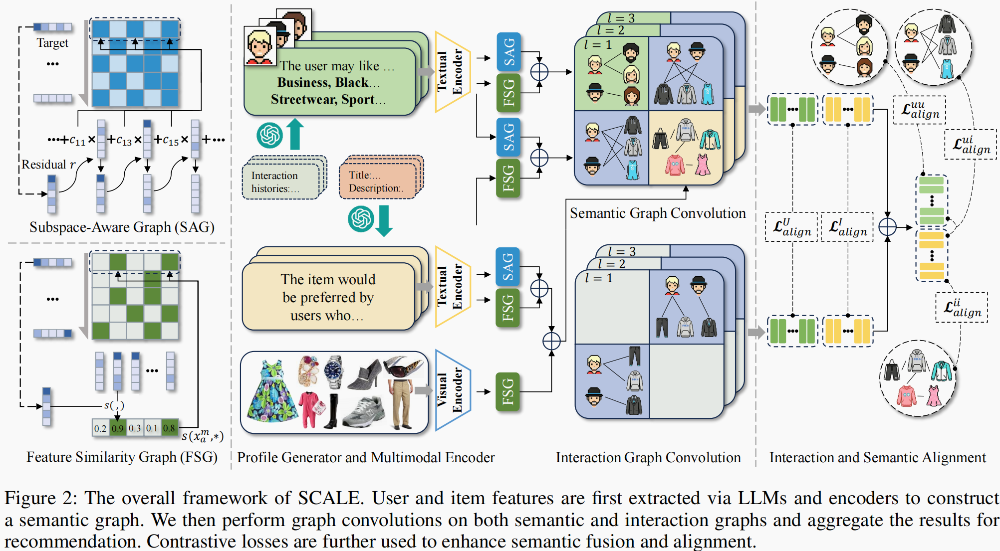

## SCALE
Subspace-Aware Graph Construction and Contrastive Alignment for \\Multimodal Recommendation with Large Language Models

*We propose a multimodal recommendation framework that captures comprehensive semantics via subspace-aware graph construction and integrates semantics with collaborative signals through contrastive alignment, achieving state-of-the-art performance.*

<p>

</p>


## 👉 Quick Start for SCALE

### Dependencies

SCALE is implemented based on $\text{MMRec}$([arXiv](https://arxiv.org/abs/2302.03497)) and their contribution is greatly appreciated. Our experiments have been tested on Python 3.8.20 with PyTorch 2.4.0+cu121.
 Set up a virtualenv and install the [pytorch](https://pytorch.org/get-started/previous-versions/) manually. After that, install all the dependencies listed in the `requirements.txt` file by running the following command:

```bash
pip install -r requirements.txt
```


### Dataset downloading

Please download the datasets and put the unzipped dataset in the `data` folder:

Example of the file structure:
```
├── preprocessing/
├── src/
├── data/
    ├── sports/ # target datasets
        ├── i_id_mapping.csv/ 
        ├── u_id_mapping.csv/ 
        ├── sports.inter/ 
        ├── image_feat.npy/ 
        ├── LLM_generate_data/ 
            ├── llm_text_feat.npy/
            ├── llm_user_feat.npy/
            ├── mat_file/
                ├── ssc_omp_knn_C_top5_temp_item_item_indices_spa20_1e1_sports.pt/
                ├── ssc_omp_knn_C_top5_temp_user_item_indices_spa20_1e1_sports.pt/
                ├── ssc_omp_knn_C_top5_temp_user_user_indices_spa20_1e1_sports.pt/
```

### Commands for running 
Sports
```bash
python main.py --model SCALE --dataset sports
```


